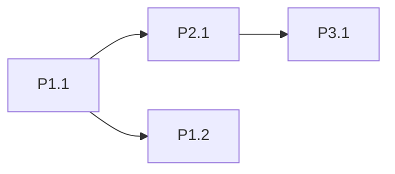

# PARTS: __PROJ__

## Parts
| Part | Name | Owns (paths) | Size | Brief |
|---|---|---|---|---|
| 1 | skeleton + shared types | `packages/shared`, repo root | S | `parts/P01_skeleton.md` |

## Dispatch table (coordinator runs on this)
One row per step that waits on ANOTHER part (a part's own steps run in order without rows). Coordinator sends `START P<n>.<s>` once every Need is merged. Steps not listed start at launch (● in chart). Parts send `DONE` for steps that appear in some Needs column, and when the whole part is done.
| Step | Needs | Unblocks |
|---|---|---|
| P1.1 skeleton | — | P2.1, P3.1, P4.1 |
| P2.1 … | P1.1 | P4.2 |

## Flow (● start at launch, ○ wait; read left → right)
```
P1 ● 1 skeleton ━┳━ 2 data ━━━━━━━━━━━━━━━━━━━━━━━●
                 ▼ [P1.1]
P2 ○ ━━━━━━━━━━━━┻━ 1 engine ━━┳━ 2 rules ━━━━━━━━●
                               ▼ [P2.1]
P3 ○ ━━━━━━━━━━━━━━━━━━━━━━━━━━┻━ 1 server ━━━━━━━●
```



## Waves
| Wave | Parts | Date |
|---|---|---|
| 1 | 1–N | __DATE__ |
